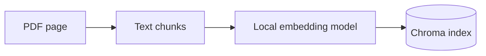
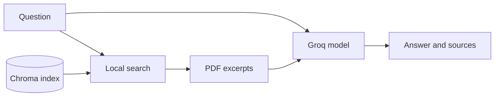

# A short guide to the PDF question answering app

Suppose you have a PDF about attention and ask, "How does the model decide which words matter?"
A chat model can give you a general answer, but it has not opened your particular PDF. This app
finds relevant text in the PDF and puts it next to your question before the model answers. That is
retrieval augmented generation, usually shortened to RAG.

The app has two jobs. You run the first when PDFs change. You run the second for each question.

## First job: make the PDFs searchable

`document-rag ingest` looks through the PDF folder and reads each page. It splits long pages into
smaller pieces called chunks. A bit of text overlaps between neighbouring chunks so a useful sentence
has a better chance of staying together. Each chunk keeps its PDF name and page number.

An embedding model turns each chunk into a list of numbers. Nearby lists tend to represent similar
text. Chroma stores the chunks, their numbers, and their page details on your computer. In this repo,
the embedding model is `sentence-transformers/all-MiniLM-L6-v2`.

Run `document-rag files` first if you are unsure which PDFs will be included. Ingest rebuilds the
index, so remove a PDF and ingest again if you want it out of the results.

## Second job: find text and answer

The same embedding model turns your question into numbers. Chroma compares them with the stored
chunks and returns the closest ones. You can see those chunks yourself with `document-rag search`.
This is a useful checkpoint: if search found the wrong page, a polished answer will not fix that.

`document-rag ask` sends the retrieved text and your question to a model hosted by Groq. The prompt
asks it to stick to the excerpts and cite them with numbers such as `[1]`. The command also prints
the PDF pages it retrieved. Check those pages when an answer matters. A nearby chunk can still be
irrelevant, and a generated citation can still be wrong.

The embeddings and Chroma index are local. When you run `ask`, the question and retrieved excerpts
go to Groq. Only index material you are allowed to use, and think about what you send to a hosted
service. `files`, `ingest`, and `search` do not need a Groq key.

## What does "agentic" add here?

`ask --agentic` does one extra check. The model looks at the first search result and judges whether
it is useful. If it says no, it rewrites the search query and tries once more. It then answers the
original question. This can help with vague wording such as "How does it know which words matter?",
but it makes extra model calls and the relevance judgement can be wrong. Try the plain `ask` command
first and compare the passages with `search`.

## Three things to check in an answer

1. Did `search` find a passage that actually addresses the question?
2. Does the answer stick to that passage, or does it add unsupported detail?
3. Does the cited PDF page say what the answer claims?

Try these checks in the [workshop](WORKSHOP.md). If retrieval is poor, experiment with the question,
`TOP_K`, or chunk size. Re-ingest after changing chunk settings. The code follows the same flow:
`document_loader.py` prepares text, `vector_store.py` stores it, `rag.py` asks the model, and
`cli.py` exposes the commands.
