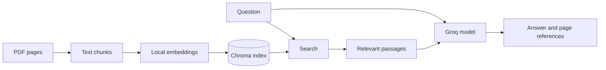

# Ask questions about your PDFs

Put a few PDFs in a folder, build a local search index, and ask questions with page references. This
repo is a small RAG practice project. It comes with `data/pdf/Attention.pdf` and `Embedding.pdf`, so
you can try it straight away. You can also use your own University of Salford handouts or other PDFs
you have permission to use.

The [mini lecture](MINI_LECTURE.md) explains the idea. The [workshop](WORKSHOP.md) gives you a short
exercise to run and check yourself.

## Start here

You'll need Python 3.11 to 3.13 and [uv](https://docs.astral.sh/uv/). From a terminal:

```text
git clone https://github.com/alifarzadjamali/local-document-rag-qa.git
cd local-document-rag-qa
uv sync --frozen
uv run document-rag files
uv run document-rag ingest
uv run document-rag search "What is attention in a transformer?"
```

`files` lists the PDFs the app can see. `ingest` reads them, splits their text into chunks, and saves
a search index in `data/vector_store/`. `search` shows the retrieved passages with filenames and page
numbers. These steps run without a Groq key. The first ingest downloads a local embedding model.

To get a written answer, copy `.env.example` to `.env` and add your own [Groq key](https://console.groq.com/keys):

```text
uv run document-rag ask "What is attention in a transformer?"
```

In PowerShell, copy the file with `Copy-Item .env.example .env`. On macOS or Linux, use
`cp .env.example .env`. The answer should cite numbered excerpts such as `[1]`; check the listed PDF
pages before relying on it.

## Use a different set of PDFs

Put files in `data/pdf/`, including subfolders if useful, then run `ingest` again. Or keep course
notes in another folder:

```text
uv run document-rag files --documents path/to/my/pdfs
uv run document-rag ingest --documents path/to/my/pdfs
uv run document-rag search "What does the handout say about assessment?"
uv run document-rag ask "What does the handout say about assessment?"
```

Each ingest replaces the old index with the contents of the chosen folder. If you switch folders,
run it again before asking questions. PDFs need selectable text; scanned images need OCR first.
Keep private course materials out of Git. Retrieved passages are sent to Groq when you use `ask`.

## What happens inside



Read the code in this order: `document_loader.py` loads pages and chunks them;
`vector_store.py` builds the index; `rag.py` assembles the prompt and answer; `cli.py` connects the
commands. `agentic_rag.py` is an optional one-retry experiment. Try
`uv run document-rag ask --agentic "How does it know which words matter?"` after the basic path works.
It makes more model calls, so start with the plain `ask` command.

## Settings and checks

`.env.example` shows the available settings. `CHUNK_SIZE` and `CHUNK_OVERLAP` control how pages are
split; `TOP_K` controls how many passages are retrieved. The default embedding model runs locally on
the CPU. If you change `EMBEDDING_MODEL`, remove the old `data/vector_store/` directory and ingest
again. `.env` and the index are ignored by Git.

```text
uv run --group dev pytest
uv run --group dev ruff check .
uv run --group dev ruff format --check .
```

The tests use fake models and do not need a key. The app needs an internet connection for the first
embedding model download and for Groq answers. A good answer still needs checking: retrieval may
find the wrong passage, and a model citation can be wrong.

## License

[MIT](LICENSE)
